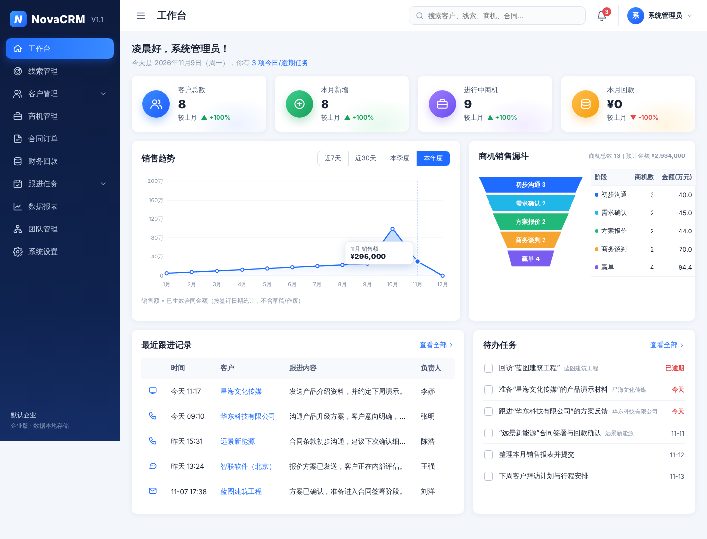

# NovaCRM V1.6 · 可离线运行的 Web CRM

> V1.6：企业微信/钉钉个人工作通知、通知链接登录后直达、安全自查修复（见 REVIEW 第八、九节）。
>
> V1.5：钉钉客户端内免登（工作台打开自动登录）。
>
> V1.4：企业微信 / 钉钉扫码登录（含企业微信客户端内免登、个人菜单自助绑定），见 REVIEW 第七节。
>
> V1.3：附件纳入备份、Excel 导入导出、邮件通知、两步验证二维码、OIDC 单点登录，见 REVIEW 第六节。
>
> V1.2：数据权限、整数分金额、定时备份、HTTPS 部署、导入/附件/对账/自定义字段/通知/多级审批、两步验证、E2E 与 CI，见 REVIEW 第五节与 [docs/DEPLOY.md](docs/DEPLOY.md)。
>
> V1.1：对照原型完成代码审查与功能补全，详见 [docs/REVIEW_V1.1.md](docs/REVIEW_V1.1.md)（问题清单、补全清单、验证结果与下一步建议）。



> 交付性质：**独立 CRM 功能 V1.0**。原演示视频在当前运行环境中无法读取，故**未取得录屏 1:1 复刻验收**。UI 与视频的差异尚不可量化。

## 运行条件

- Node.js **22.13+**（自带实验性 `node:sqlite`）；Windows 11 / macOS / Linux 均可。
- 不需要 `npm install`、第三方 CDN 或 PostgreSQL。
- 首次运行：

```bash
cd NovaCRM_V1.0
node server.js
```

打开 <http://localhost:3100>。首次启动终端显示管理员邮箱与**一次性生成**的初始密码。管理员登陆后应立即修改密码。建议生产首次安装时先设置 `CRM_ADMIN_PASSWORD` 环境变量（12 位以上）；程序只在第一次建库时使用该值。

## Docker

```bash
cp .env.example .env
# 修改 .env 为你自己的强密码
# 本地 Docker Desktop / Linux：
docker compose up -d --build
# 查看首次启动信息
docker compose logs crm
```

默认仅监听宿主机回环地址 `127.0.0.1:3100`。**对外开放需自配 HTTPS 反向代理、设置 COOKIE_SECURE=1 及 PUBLIC_ORIGIN=https://实际域名**。Docker Compose 未自动配置 TLS。

## 模块及实现边界

> 以下为 V1.0 原始说明；V1.1 新增的工作台趋势/漏斗、客户详情、商机看板拖拽与转合同、合同审批、回款计划与应收、数据报表、团队管理、系统设置（字典/审计）、全局搜索、移动端适配等，见 REVIEW_V1.1.md。

- 工作台：实时 KPI、销售漏斗、待办；使用真实数据库数据。
- 线索：CRUD、关键词搜索、事务化转客户、防重复转换。
- 客户、联系人、商机、任务、跟进、合同、回款：CRUD（回款仅添加/删除，防止直接修改金额绕开校验）。
- 合同回款约束：不允许累计到账超过合同总额，金额最多两位小数。
- 权限：`admin` 全权限；`manager` 可新增、修改、删除及审计；`sales` 可新增、修改及导出；`viewer` 只读。**同角色下尚未实现精细负责人/部门数据范围权限**。
- 多租户：所有业务查询按服务端会话 tenant_id 过滤；默认安装创建单租户，尚未提供租户自主注册或管理控制台。
- 数据：SQLite WAL 文件存储；数据不会随刷新丢失。CSV 导出为 UTF-8 BOM。
- 审计：写操作记录操作者、时间、实体，编辑保留之前的记录 JSON；仅最近 300 条提供 UI 查看。
- 后台登录：scrypt 加盐密码散列、随机会话、HttpOnly + SameSite Cookie、8h 有效期、退出注销。

**尚未实现**：视频逐帧精准复刻、SaaS 付费/租户注册、审批工作流、附件上传、微信集成、消息推送、批量导入、复杂自定义字段、AI 跟进生成、生产级限流/防爆破、SSO/MFA、字段级 ACL、分布式架构及正式渗透测试。不得将此 V1.0 描述为大型企业可直接公网运营的商用系统。

## 验收

```bash
npm run check
npm test        # API 集成测试
npm run e2e     # 浏览器端到端测试（需 Playwright + Chromium）
npm run backup
```

演示数据（仅演示环境）：服务启动后执行

```bash
CRM_URL=http://localhost:3100 CRM_PASSWORD=你的管理员密码 npm run seed
```

`npm test` 自动启动隔离数据库和服务，检查登录、线索转客户、客户/合同/回款、金额约束、权限、会话、CSV、页面可达与审计。端到端浏览器视觉复验尚未覆盖。

## 数据与运维

- 本地数据库 `data/crm.sqlite`（会同时产生 `-wal`、`-shm`），不可在运行时单独复制主文件来备份。
- `npm run backup` 使用 SQLite `VACUUM INTO` 在线一致性快照保存到 `data/backups/`。
- 恢复：停止服务；保留原数据库及 wal/shm 文件备份；把选定快照复制为 `data/crm.sqlite`（且确保旧 WAL/SHM 不再与快照混用）；重启。生产恢复建议先在隔离环境校验。
- Docker 数据位于 named volume `crm_data`；升级前建议先备份并记下当前镜像版本，以便重建回滚。

## 项目结构

`server.js` 全部 HTTP API 和 SQLite 模型；`public/index.html` + `public/app.js` + `public/style.css` 响应式 SPA；`tests/integration.test.js` 自动化集成测试；`scripts/backup.js` 数据库快照；`docs/` PRD、验收报告、视频证据状态。

## 遗留风险说明

本系统用 Node 原生 HTTP + SQLite 以实现免依赖运行，**不是先前规划的 React + NestJS + PostgreSQL 架构**。若后续需要高并发、多节点或复杂审批，应逐步迁移。不得以架构描述代替实际实现。
